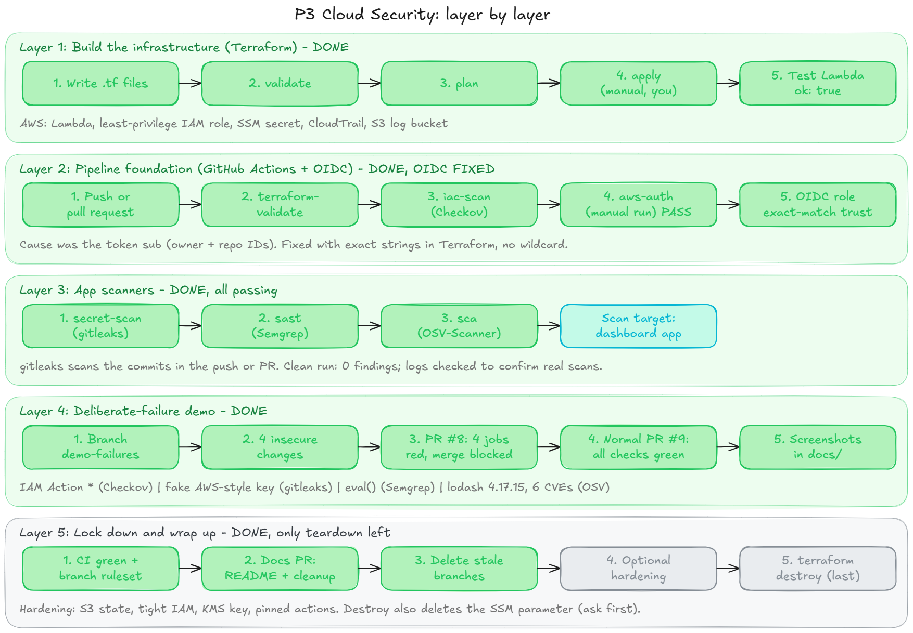
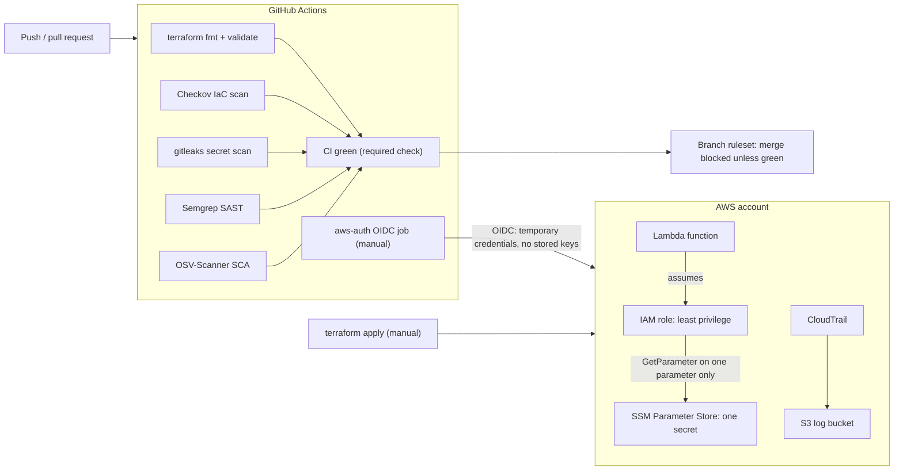
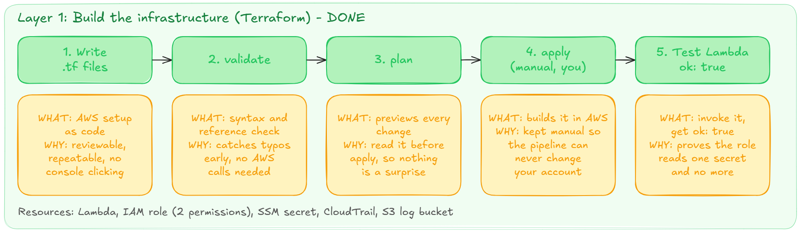
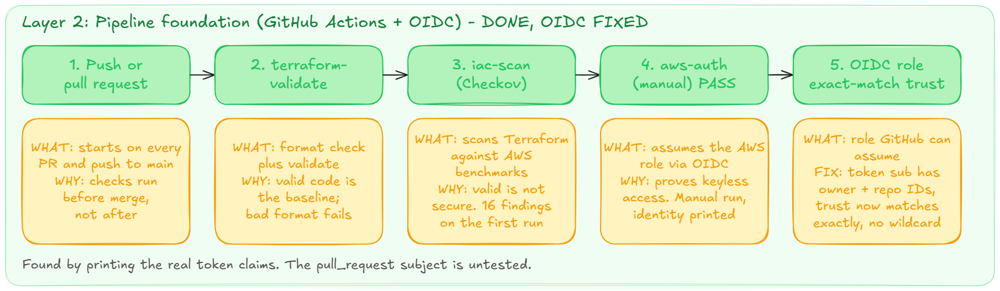
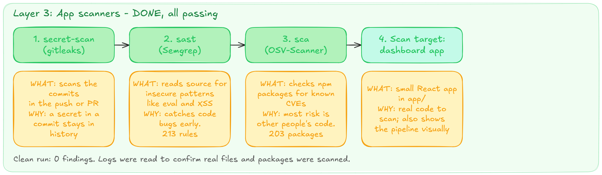
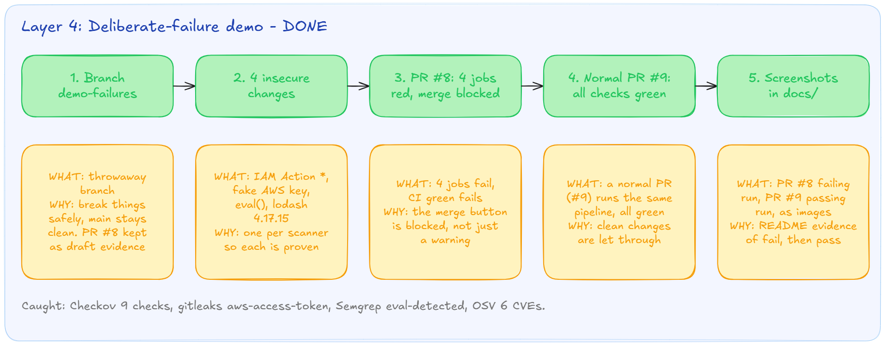
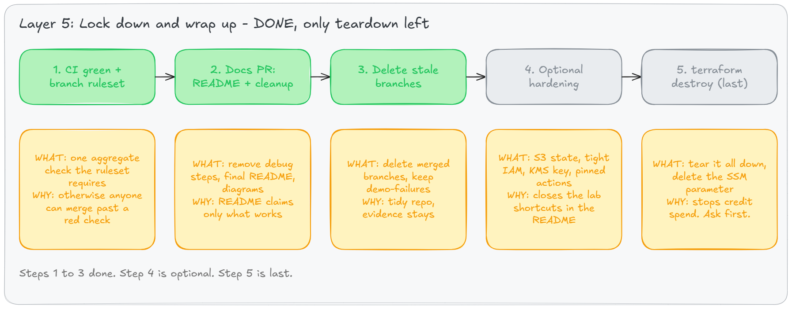
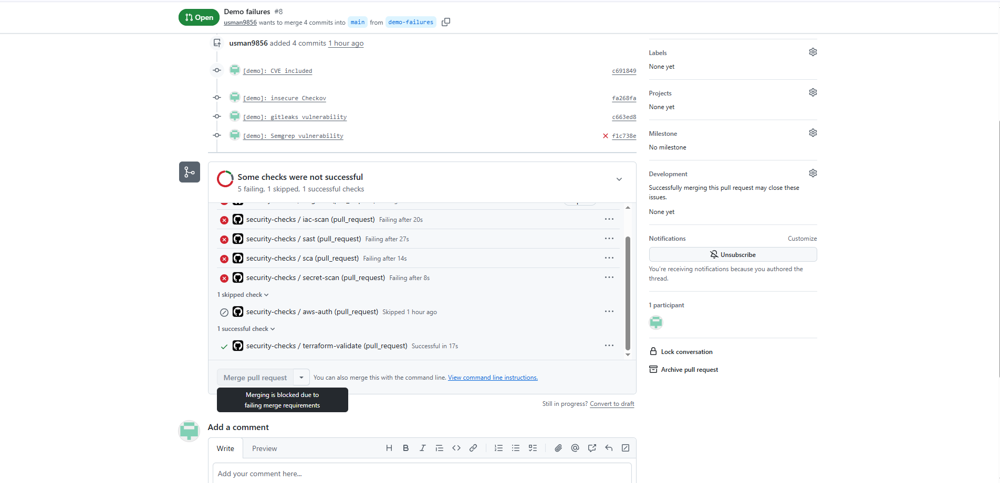
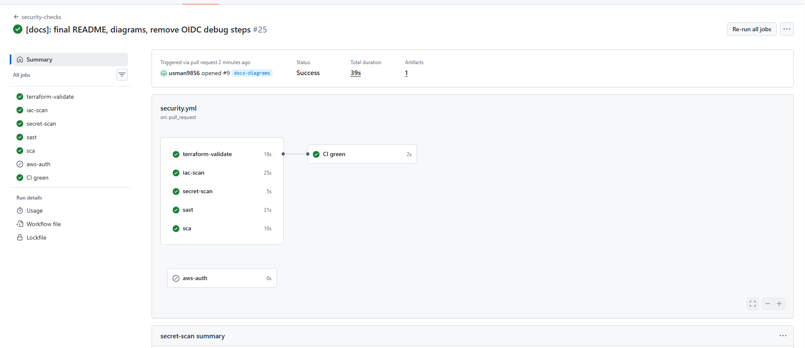
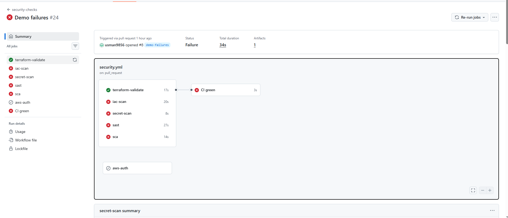

# Cloud Security: Compliant-by-Pipeline Infrastructure

[](https://github.com/usman9856/cloud-security-pipeline/actions/workflows/security.yml)

Real AWS infrastructure, written as code with Terraform and locked down with least-privilege IAM. Every push and pull request runs a GitHub Actions pipeline that checks the code and **fails the build** when something insecure sneaks in. Merging to `main` is blocked until every check is green.

> **Status:** five scanning jobs and one aggregate gate are built and passing. A manual job, `aws-auth`, proves the pipeline can assume an AWS role through GitHub OIDC with no stored keys. A deliberate-failure demo shows the pipeline catching four insecure changes and blocking the merge. Nothing in this README claims more than what exists. Items marked _(planned)_ are not built.

## What this proves

- I can design **least-privilege cloud infrastructure** and express it as code.
- I can **enforce security automatically** (IaC, secret, code and dependency scanning) instead of by hand.
- I can **debug a real cloud identity problem** from evidence, without loosening security to make an error go away (see [the OIDC troubleshooting](#troubleshooting-github-oidc-role-assumption-failed)).



## What this is

A small, deliberately minimal AWS setup:

- **A Lambda function** that reads one secret and returns `ok: true`. It never returns or logs the secret value.
- **A least-privilege IAM role** for that Lambda with exactly two permissions: write to its own log group, and `ssm:GetParameter` on that one parameter. No wildcards on allow statements.
- **CloudTrail** audit logging into a locked-down S3 bucket (public access blocked, versioning on, HTTPS-only, 90-day expiry, log file validation on).
- **A GitHub OIDC role** so the pipeline can get temporary AWS access with no long-lived keys stored in GitHub. Its trust policy matches exact subject strings for this repo's `main` branch and pull requests, with no wildcard.
- **A small dashboard app** (`app/`) that visualises the pipeline, findings and permissions. It runs in mock mode and also serves as the scan target for the SAST and SCA jobs.

The Lambda is intentionally tiny. It exists so the IAM policies have something real to protect. The point of the project is the security around it.

## Architecture



### How it was built, layer by layer

<details>
<summary>Detailed step-by-step diagrams: what each step does and why</summary>

**Layer 1: build the infrastructure (Terraform)**


**Layer 2: pipeline foundation (GitHub Actions + OIDC)**


**Layer 3: app scanners**


**Layer 4: deliberate-failure demo**


**Layer 5: lock down and wrap up**


</details>

## What the pipeline does

Runs on every pull request and every push to `main`.

| Job                  | What it checks                                                                                     | Blocks merge?        |
| -------------------- | -------------------------------------------------------------------------------------------------- | -------------------- |
| `terraform-validate` | `terraform fmt -check` (formatting) and `terraform validate` (syntax and references)               | Yes, via `CI green`  |
| `iac-scan`           | [Checkov](https://www.checkov.io/) scans the Terraform against AWS security benchmarks             | Yes, via `CI green`  |
| `secret-scan`        | gitleaks scans the commits in the push or pull request for committed secrets                       | Yes, via `CI green`  |
| `sast`               | [Semgrep](https://semgrep.dev/) (`p/default` ruleset) scans the app and Lambda source              | Yes, via `CI green`  |
| `sca`                | [OSV-Scanner](https://google.github.io/osv-scanner/) checks npm dependencies for known CVEs        | Yes, via `CI green`  |
| `CI green`           | Fails unless all five jobs above succeeded. A failed, cancelled or skipped job counts as a failure | **Required check**   |
| `aws-auth`           | Assumes the AWS OIDC role with no stored keys, then runs `aws sts get-caller-identity`             | No (manual run only) |

`main` is protected by a branch ruleset: changes need a pull request and a passing `CI green`. The single aggregate check means adding or renaming a scan job only needs a change to the workflow, not to the repo settings.

`terraform apply` stays **manual** on purpose: the pipeline never changes the AWS account. Terraform state is local, so the pipeline does not run `plan` yet.

### What the app scanners covered

The dashboard in `app/` (React + Vite + TypeScript, mock mode) is the scan target for SAST and SCA.

| Job    | What it scanned                                        | Result                  |
| ------ | ------------------------------------------------------ | ----------------------- |
| `sast` | 16 git-tracked files in `app/src` and `src`, 213 rules | 0 findings              |
| `sca`  | 203 npm packages from `app/package-lock.json`          | 0 known vulnerabilities |

A clean result shows the checks ran, not that they catch anything. The demo below shows them catching real problems.

Scope limits: SCA covers only the dashboard's lockfile (the Lambda has no dependencies), and Semgrep scans only files tracked by git.

## Deliberate-failure demo

To prove the scanners catch real problems, I committed one insecure change per scanner on a throwaway branch.

**Before:** [PR #8](https://github.com/usman9856/cloud-security-pipeline/pull/8) contains four insecure changes. All four scanners fail, `CI green` fails, and the merge button is blocked. The PR is kept open as a draft so the failing run stays on record.



**After (passing run):** a normal pull request ([PR #9](https://github.com/usman9856/cloud-security-pipeline/pull/9)) runs the same pipeline. All five scan jobs and `CI green` pass, and the merge is allowed. I did not build a separate "fixed" copy of the four demo changes. The fix for each one is in the table below.





| Scanner     | What I committed                                       | What it caught                                                                                                   | Why it matters                                                      | How to fix                                         |
| ----------- | ------------------------------------------------------ | ---------------------------------------------------------------------------------------------------------------- | ------------------------------------------------------------------- | -------------------------------------------------- |
| Checkov     | An IAM policy with `Action = "*"` and `Resource = "*"` | 9 checks failed on the policy (`CKV_AWS_62`, `CKV_AWS_63`, `CKV_AWS_355`, `CKV2_AWS_40`, `CKV_AWS_286` to `290`) | Anyone who assumes the role gets full admin                         | Name specific actions and resources                |
| gitleaks    | A made-up AWS access key in a file                     | Rule `aws-access-token`, with file, line and commit                                                              | A committed key stays in git history even after the file is deleted | Remove it, and **revoke and rotate** a real key    |
| Semgrep     | `eval()` on input in a TypeScript file                 | `javascript.browser.security.eval-detected.eval-detected` (blocking)                                             | Runs attacker-controlled code                                       | Use `JSON.parse` or an allowlist instead of `eval` |
| OSV-Scanner | `lodash 4.17.15`                                       | 6 known vulnerabilities (3 High, 3 Medium)                                                                       | Known exploits ship with the dependency                             | Upgrade to `4.17.21` or later, or remove it        |

Notes on the demo:

- The access key is made up and tied to no AWS account. It lives only in PR #8's history.
- gitleaks reads each commit's diff, so deleting a leaked file in a later commit does not clear the finding. That is why a leak needs the key revoked and rotated, not just a follow-up commit that removes the file.
- Nothing from the demo branches was applied to AWS.

## Troubleshooting: GitHub OIDC role assumption failed

**Symptom:** the `aws-auth` job failed with `Not authorized to perform sts:AssumeRoleWithWebIdentity`, even though the role, OIDC provider, audience and job permissions were all correct.

**Diagnosis:** a temporary debug step (since removed) decoded the OIDC token and printed its `sub` claim. It did not match the trust policy:

|                       | Value                                                        |
| --------------------- | ------------------------------------------------------------ |
| Trust policy expected | `repo:<owner>/<repo>:ref:refs/heads/main`                    |
| Token actually sent   | `repo:<owner>@<ownerID>/<repo>@<repoID>:ref:refs/heads/main` |

The repository has GitHub's immutable OIDC subject format enabled (`use_immutable_subject: true`), which embeds the numeric owner and repo IDs in the `sub`. AWS compares the condition as a string, so the trust policy never matched. My first guess, a customized subject template, was wrong: the API showed `use_default: true`, and the immutable setting was the real cause.

**Fix:** updated the `github_repo` value in Terraform so the trust policy uses the exact immutable subject strings. The change was reviewed as a plan (1 changed, 0 added, 0 destroyed) before apply.

**Why not a wildcard?** `repo:<owner>/<repo>:*` would have worked, but it lets any branch, tag or workflow in the repo assume the role. Exact strings keep least privilege. The immutable format is also safer, because a deleted and re-created repo with the same name cannot inherit the trust.

**Result:** `aws-auth` assumes the role through OIDC with no stored AWS keys, and `aws sts get-caller-identity` returns the assumed-role ARN.

**Limit of the proof:** only the `main` subject has been exercised, because `aws-auth` is a manual job. The `pull_request` subject in the trust policy follows the same pattern but has not been tested by a run.

**Lessons**

- Print the real token claims before changing a trust policy.
- Check what the token contains, not what you assume it contains.
- Keep trust conditions exact; do not loosen them to make an error go away.

## Evidence: the pipeline catching real findings

The first pull request ran the pipeline three times:

| Run | Result                                         | What happened                                                |
| --- | ---------------------------------------------- | ------------------------------------------------------------ |
| #1  | Failed: 16 Checkov findings (78 checks passed) | First scan of the Layer 1 code                               |
| #2  | Failed: 5 findings                             | After documenting 11 accepted skips in `.checkov.yaml`       |
| #3  | Passed                                         | After fixing 2 real findings and documenting 3 deferred ones |

### What the 16 findings were, and what I did

**Fixed in code (2)**

| Check         | What it was                                                      | Why it matters                                                   | Fix                                                    |
| ------------- | ---------------------------------------------------------------- | ---------------------------------------------------------------- | ------------------------------------------------------ |
| `CKV_AWS_300` | The S3 lifecycle rule did not abort incomplete multipart uploads | Failed uploads sit in the bucket unseen and keep costing storage | Added `abort_incomplete_multipart_upload` after 7 days |
| `CKV_AWS_338` | Lambda log group kept logs only 14 days                          | Too short to investigate an incident found later                 | Retention raised to 365 days                           |

**Deferred, real gaps (3)**

| Check         | Gap                                                           | Plan                                               |
| ------------- | ------------------------------------------------------------- | -------------------------------------------------- |
| `CKV_AWS_35`  | CloudTrail logs not encrypted with a customer-managed KMS key | One KMS key covering all three; needs key policies |
| `CKV_AWS_158` | Log group not encrypted with a customer-managed KMS key       | Same key                                           |
| `CKV_AWS_145` | S3 bucket uses default AES256, not a KMS key                  | Same key                                           |

These resources are already encrypted at rest with AWS-managed keys. A customer-managed key adds key-level access control and its own audit trail. Listed in `.checkov.yaml` as "deferred", not "not applicable".

**Accepted, with a reason (11)**: each is listed in `.checkov.yaml` with a comment.

| Check                                       | Why accepted                                                               |
| ------------------------------------------- | -------------------------------------------------------------------------- |
| `CKV_AWS_117` Lambda in a VPC               | Needs NAT or endpoints, excluded for cost                                  |
| `CKV_AWS_50` X-Ray tracing                  | Needs a wildcard-resource permission, which conflicts with least privilege |
| `CKV_AWS_115` Reserved concurrency          | Can fail on new-account limits                                             |
| `CKV_AWS_272` Code signing                  | Out of scope for a demo function                                           |
| `CKV_AWS_116` Dead letter queue             | Applies to async invokes only; this function is invoked directly           |
| `CKV_AWS_173` Env var encryption            | The variable holds a parameter name, not a secret                          |
| `CKV_AWS_252` CloudTrail SNS topic          | No notification requirement                                                |
| `CKV2_AWS_10` CloudTrail to CloudWatch Logs | Extra cost, out of scope                                                   |
| `CKV2_AWS_62` S3 event notifications        | Not needed for a log bucket                                                |
| `CKV_AWS_144` Cross-region replication      | Cost, out of scope for a lab                                               |
| `CKV_AWS_18` S3 access logging              | Logging the log bucket creates a loop                                      |

## Repo layout

| File                             | Purpose                                                                                                                          |
| -------------------------------- | -------------------------------------------------------------------------------------------------------------------------------- |
| `providers.tf`                   | AWS and archive providers, pinned versions, region and account lookups                                                           |
| `variables.tf`                   | Region, name prefix, secret parameter name                                                                                       |
| `iam.tf`                         | The Lambda's role and policy, with a "why" comment on every permission                                                           |
| `lambda.tf` + `src/index.mjs`    | The function, its log group, and its code                                                                                        |
| `cloudtrail.tf`                  | Audit trail and its locked-down log bucket                                                                                       |
| `github-oidc.tf`                 | OIDC provider and a read-only role GitHub Actions can assume, limited to exact subjects for this repo's `main` and pull requests |
| `outputs.tf`                     | Function name, role ARNs, log bucket name                                                                                        |
| `app/`                           | Dashboard app used as the SAST and SCA scan target                                                                               |
| `docs/`                          | Diagrams and screenshots used in this README                                                                                     |
| `.github/workflows/security.yml` | The pipeline                                                                                                                     |
| `.checkov.yaml`                  | Accepted and deferred Checkov checks, each with a reason                                                                         |

## Run it yourself

Needs Terraform 1.6 or newer, the AWS CLI, and an AWS account with credentials configured.

```bash
# 1. Create the secret OUTSIDE Terraform so its value never lands in state
aws ssm put-parameter --name /p3-cloudsec/demo-api-key --type SecureString \
  --value "not-a-real-secret" --region us-east-1

# 2. Build
terraform init
terraform validate
terraform plan
terraform apply

# 3. Test
aws lambda invoke --function-name p3-cloudsec-fn out.json && cat out.json

# 4. Tear down so nothing keeps costing money
terraform destroy
aws ssm delete-parameter --name /p3-cloudsec/demo-api-key --region us-east-1
```

On Windows with Git Bash, prefix any AWS CLI command that takes a `/`-leading value with `MSYS_NO_PATHCONV=1`. Otherwise Git Bash rewrites the path and AWS reports `ParameterNotFound`.

`terraform destroy` also removes the OIDC role. Re-running `terraform apply` recreates it. To use the `aws-auth` job, set the repository **variable** (not secret) `AWS_ROLE_ARN` to the role's ARN.

**If you fork this:** the `github_repo` default in `github-oidc.tf` holds this repo's owner and repo IDs in GitHub's immutable subject format (`owner@ownerID/name@repoID`). Replace it with your own, or the OIDC role will refuse your pipeline.

Never commit `terraform.tfstate`, `.terraform/`, or `*.tfvars`. The `.gitignore` already excludes them.

## What I've learned

- **The Terraform workflow:** `init` downloads plugins, `validate` checks the code, `plan` previews without changing anything, `apply` builds, `destroy` removes it all. Reading the plan before applying is the habit that matters.
- **Least privilege means being specific.** The Lambda role names two exact actions on two exact resources. A `Deny` with `s3:*` on the log bucket is fine, because it restricts access (HTTPS only) rather than granting it.
- **Keep secrets out of state.** If Terraform created the secret, its value would sit in the state file. The parameter is created separately and Terraform only knows its name.
- **State files are sensitive.** `terraform.tfstate` holds account details and resource IDs, so it must never reach Git.
- **CloudTrail proves what actually happened.** The event history shows the Lambda running as the assumed role and writing only to its own log group.
- **IAM is eventually consistent.** Terraform retried `CreateFunction` a few times until the new role propagated. The errors were noise, not a bug.
- **Valid is not secure.** `terraform validate` passes code that Checkov rejects, so the pipeline needs both.
- **Scanner rules target production.** Most of the 16 findings were sensible for a large system and overkill for a lab. The discipline is to fix the real ones and document every skip with a reason, not to switch the scanner off.
- **`known after apply` means "can't tell yet".** A plan line like that is not a change.
- **Pull requests leave a trail.** Changes go through a PR so the failing and passing runs stay on record.
- **A green scanner needs checking too.** I read the SAST and SCA logs to confirm they scanned real files and packages before trusting "0 findings". A scanner pointed at the wrong path passes silently.
- **One AWS error, many causes.** "Not authorized to perform sts:AssumeRoleWithWebIdentity" is the same message whether the trust policy, the OIDC provider, the role ARN or the token claims are wrong. Printing the real token claims found the cause.
- **A red check only blocks if something enforces it.** The aggregate `CI green` check plus a branch ruleset is what turns a scanner failure into a blocked merge.
- **Deleting a leaked secret is not enough.** It stays in git history, so a real key has to be revoked and rotated.

## Known shortcuts (lab, not production)

- The deploying IAM user has `AdministratorAccess` to avoid permission friction while learning. A real setup would scope it down.
- The OIDC role uses the AWS-managed `ReadOnlyAccess` policy. It is broader than the pipeline needs (it can read the SSM secret). The only job that uses it, `aws-auth`, just prints the assumed identity.
- The log bucket uses `force_destroy = true` so `terraform destroy` works cleanly.
- Terraform state is local. A team setup would use a remote backend with locking, which would also let the pipeline run `plan`.
- Encryption uses AWS-managed keys. Customer-managed KMS keys are deferred (see above).
- The branch ruleset requires a pull request and `CI green` but no approving reviews, because this is a solo repo.
- GitHub Actions are pinned by version tag, not commit SHA, and the Semgrep container image is not pinned. OSV-Scanner is pinned (v2.3.8).
