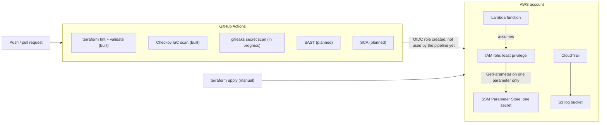

# Cloud Security: Compliant-by-Pipeline Infrastructure

Real AWS infrastructure, written as code with Terraform and locked down with least-privilege IAM. Every push and pull request runs a GitHub Actions pipeline that checks the code and **fails the build** when something insecure sneaks in.

> **Status: Layers 1 and 2 complete. Secret scanning is in progress; SAST and SCA are next.** Nothing in this README claims more than what exists. Items marked _(planned)_ or _(in progress)_ are not built yet.

## What this is

A small, deliberately minimal AWS setup:

- **A Lambda function** that reads one secret and returns `ok: true`. It never returns or logs the secret value.
- **A least-privilege IAM role** for that Lambda with exactly two permissions: write to its own log group, and `ssm:GetParameter` on that one parameter. No wildcards on allow statements.
- **CloudTrail** audit logging into a locked-down S3 bucket (public access blocked, versioning on, HTTPS-only, 90-day expiry, log file validation on).
- **A GitHub OIDC role** so a pipeline can get temporary AWS access with no long-lived keys stored in GitHub. It is created by Terraform but not yet used by the pipeline (see Known shortcuts).

The Lambda is intentionally tiny. It exists so the IAM policies have something real to protect. The point of the project is the security around it.

## What the pipeline does today

Runs on every push to `main` and every pull request. Each job fails the build on findings.

| Job                  | What it checks                                                                         | Status      |
| -------------------- | -------------------------------------------------------------------------------------- | ----------- |
| `terraform-validate` | `terraform fmt -check` (formatting) and `terraform validate` (syntax and references)   | Built       |
| `iac-scan`           | [Checkov](https://www.checkov.io/) scans the Terraform against AWS security benchmarks | Built       |
| `secret-scan`        | gitleaks scans the full git history for committed secrets                              | In progress |
| SAST                 | Static analysis of application code                                                    | Planned     |
| SCA                  | Dependency vulnerability scan                                                          | Planned     |

`terraform apply` stays **manual** on purpose: the pipeline never changes the AWS account. Terraform state is local, so the pipeline does not run `plan` yet.

## Architecture



## Evidence: the pipeline catching real findings

The first pull request ran the pipeline three times:

| Run | Result                                         | What happened                                                |
| --- | ---------------------------------------------- | ------------------------------------------------------------ |
| #1  | Failed: 16 Checkov findings (78 checks passed) | First scan of the Layer 1 code                               |
| #2  | Failed: 5 findings                             | After documenting 11 accepted skips in `.checkov.yaml`       |
| #3  | Passed                                         | After fixing 2 real findings and documenting 3 deferred ones |

<!-- Add a screenshot of the Actions run history as docs/pipeline-runs.png, then replace this comment with:  -->

### What the 16 findings were, and what I did

**Fixed in code (2)**

| Check         | What it was                                                      | Why it matters                                                   | Fix                                                    |
| ------------- | ---------------------------------------------------------------- | ---------------------------------------------------------------- | ------------------------------------------------------ |
| `CKV_AWS_300` | The S3 lifecycle rule did not abort incomplete multipart uploads | Failed uploads sit in the bucket unseen and keep costing storage | Added `abort_incomplete_multipart_upload` after 7 days |
| `CKV_AWS_338` | Lambda log group kept logs only 14 days                          | Too short to investigate an incident found later                 | Retention raised to 365 days                           |

**Deferred, real gaps (3)**

| Check         | Gap                                                           | Plan                                               |
| ------------- | ------------------------------------------------------------- | -------------------------------------------------- |
| `CKV_AWS_35`  | CloudTrail logs not encrypted with a customer-managed KMS key | One KMS key covering all three; needs key policies |
| `CKV_AWS_158` | Log group not encrypted with a customer-managed KMS key       | Same key                                           |
| `CKV_AWS_145` | S3 bucket uses default AES256, not a KMS key                  | Same key                                           |

These resources are already encrypted at rest with AWS-managed keys. A customer-managed key adds key-level access control and its own audit trail. Listed in `.checkov.yaml` as "deferred", not "not applicable".

**Accepted, with a reason (11)**: each is listed in `.checkov.yaml` with a comment.

| Check                                       | Why accepted                                                               |
| ------------------------------------------- | -------------------------------------------------------------------------- |
| `CKV_AWS_117` Lambda in a VPC               | Needs NAT or endpoints, excluded for cost                                  |
| `CKV_AWS_50` X-Ray tracing                  | Needs a wildcard-resource permission, which conflicts with least privilege |
| `CKV_AWS_115` Reserved concurrency          | Can fail on new-account limits                                             |
| `CKV_AWS_272` Code signing                  | Out of scope for a demo function                                           |
| `CKV_AWS_116` Dead letter queue             | Applies to async invokes only; this function is invoked directly           |
| `CKV_AWS_173` Env var encryption            | The variable holds a parameter name, not a secret                          |
| `CKV_AWS_252` CloudTrail SNS topic          | No notification requirement                                                |
| `CKV2_AWS_10` CloudTrail to CloudWatch Logs | Extra cost, out of scope                                                   |
| `CKV2_AWS_62` S3 event notifications        | Not needed for a log bucket                                                |
| `CKV_AWS_144` Cross-region replication      | Cost, out of scope for a lab                                               |
| `CKV_AWS_18` S3 access logging              | Logging the log bucket creates a loop                                      |

## Repo layout

| File                             | Purpose                                                                                                              |
| -------------------------------- | -------------------------------------------------------------------------------------------------------------------- |
| `providers.tf`                   | AWS and archive providers, pinned versions, region and account lookups                                               |
| `variables.tf`                   | Region, name prefix, secret parameter name                                                                           |
| `iam.tf`                         | The Lambda's role and policy, with a "why" comment on every permission                                               |
| `lambda.tf` + `src/index.mjs`    | The function, its log group, and its code                                                                            |
| `cloudtrail.tf`                  | Audit trail and its locked-down log bucket                                                                           |
| `github-oidc.tf`                 | OIDC provider and a read-only role GitHub Actions can assume, limited to this repo's `main` branch and pull requests |
| `outputs.tf`                     | Function name, role ARNs, log bucket name                                                                            |
| `.github/workflows/security.yml` | The pipeline                                                                                                         |
| `.checkov.yaml`                  | Accepted and deferred Checkov checks, each with a reason                                                             |

## Run it yourself

Needs Terraform 1.6 or newer, the AWS CLI, and an AWS account with credentials configured.

```bash
# 1. Create the secret OUTSIDE Terraform so its value never lands in state
aws ssm put-parameter --name /p3-cloudsec/demo-api-key --type SecureString \
  --value "not-a-real-secret" --region us-east-1

# 2. Build
terraform init
terraform validate
terraform plan
terraform apply

# 3. Test
aws lambda invoke --function-name p3-cloudsec-fn out.json && cat out.json

# 4. Tear down so nothing keeps costing money
terraform destroy
aws ssm delete-parameter --name /p3-cloudsec/demo-api-key --region us-east-1
```

`terraform destroy` also removes the OIDC role. Re-running `terraform apply` recreates it.

Never commit `terraform.tfstate`, `.terraform/`, or `*.tfvars`. The `.gitignore` already excludes them.

## What I've learned so far

- **The Terraform workflow:** `init` downloads plugins, `validate` checks the code, `plan` previews without changing anything, `apply` builds, `destroy` removes it all. Reading the plan before applying is the habit that matters.
- **Least privilege means being specific.** The Lambda role names two exact actions on two exact resources. A `Deny` with `s3:*` on the log bucket is fine, because it restricts access (HTTPS only) rather than granting it.
- **Keep secrets out of state.** If Terraform created the secret, its value would sit in the state file. The parameter is created separately and Terraform only knows its name.
- **State files are sensitive.** `terraform.tfstate` holds account details and resource IDs, so it must never reach Git.
- **CloudTrail proves what actually happened.** The event history shows the Lambda running as the assumed role and writing only to its own log group.
- **IAM is eventually consistent.** Terraform retried `CreateFunction` a few times until the new role propagated. The errors were noise, not a bug.
- **Valid is not secure.** `terraform validate` passes code that Checkov rejects, so the pipeline needs both.
- **Scanner rules target production.** Most of the 16 findings were sensible for a large system and overkill for a lab. The discipline is to fix the real ones and document every skip with a reason, not to switch the scanner off.
- **`known after apply` means "can't tell yet".** A plan line like that is not a change. The Lambda policy showed it, then applied as no change.
- **Pull requests leave a trail.** Changes go through a PR so the failing and passing runs stay on record.

## Known shortcuts (lab, not production)

- The deploying IAM user has `AdministratorAccess` to avoid permission friction while learning. A real setup would scope it down.
- The OIDC role uses the AWS-managed `ReadOnlyAccess` policy. It is broader than the pipeline needs and is not used by any pipeline step yet.
- The log bucket uses `force_destroy = true` so `terraform destroy` works cleanly.
- Terraform state is local. A team setup would use a remote backend with locking, which would also let the pipeline run `plan`.
- Encryption uses AWS-managed keys. Customer-managed KMS keys are deferred (see above).
- Branch protection is not enforced, so a failing check does not yet block a merge.
