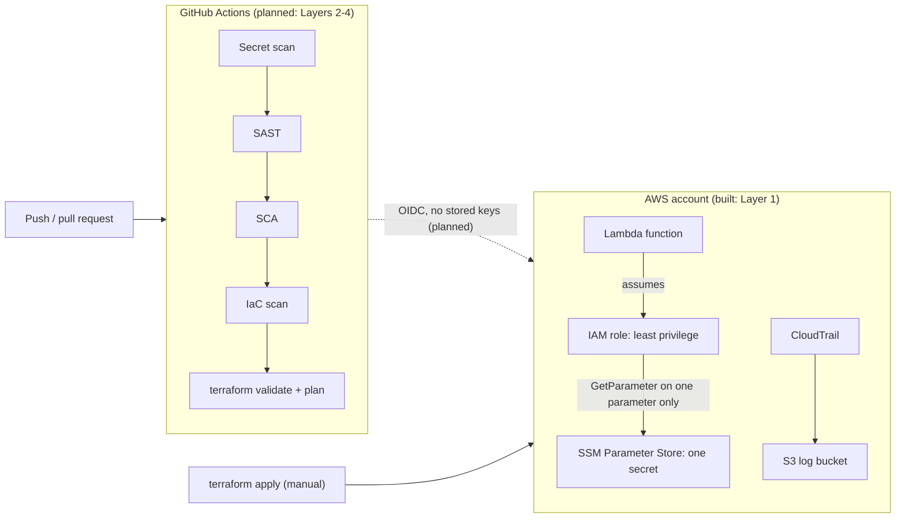

# Cloud Security: Compliant-by-Pipeline Infrastructure

Real AWS infrastructure, written as code with Terraform, locked down with least-privilege IAM, and (soon) checked automatically on every push by a GitHub Actions pipeline that **fails the build** when something insecure sneaks in.

> **Status: Layer 1 complete, pipeline in progress.** The infrastructure below is built and tested. The pipeline, the deliberate-failure demo, and the per-finding write-up are the next layers. Nothing in this README claims more than what exists.

## What this is

A small, deliberately minimal AWS setup:

- **A Lambda function** that reads one secret and returns `ok: true`. It never returns or logs the secret value.
- **A least-privilege IAM role** for that Lambda with exactly two permissions: write to its own log group, and `ssm:GetParameter` on that one parameter. No wildcards on allow statements.
- **CloudTrail** audit logging into a locked-down S3 bucket (public access blocked, versioning on, HTTPS-only, 90-day expiry, log file validation on).

The Lambda is intentionally tiny. It exists so the IAM policies have something real to protect.

## What I'm going to do with it

The point of the project is to prove I can design secure cloud infrastructure **and enforce that security automatically**, not by hand.

1. **Add a GitHub Actions pipeline** that runs on every push and pull request: secret scanning, SAST, dependency scanning, and IaC scanning, plus `terraform validate` and `plan`. Each stage fails the build above a set severity. Terraform `apply` stays manual.
2. **Authenticate with OIDC**, so the pipeline assumes an AWS role with no long-lived access keys stored in GitHub.
3. **Run a proof sequence:** commit something deliberately insecure (an over-broad IAM policy, a fake hardcoded secret, a vulnerable dependency), show the pipeline failing with scanner output, fix each finding, and show it passing.
4. **Document each finding:** what it was, why it matters, how the fix works.

Scanner choices (Semgrep, Trivy, gitleaks, or alternatives) are not final yet.

## Architecture



## Repo layout

| File                          | Purpose                                                                |
| ----------------------------- | ---------------------------------------------------------------------- |
| `providers.tf`                | AWS provider, pinned versions, region and account lookups              |
| `variables.tf`                | Region, name prefix, secret parameter name                             |
| `iam.tf`                      | The Lambda's role and policy, with a "why" comment on every permission |
| `lambda.tf` + `src/index.mjs` | The function, its log group, and its code                              |
| `cloudtrail.tf`               | Audit trail and its locked-down log bucket                             |
| `outputs.tf`                  | Function name, role ARN, log bucket name                               |

## Run it yourself

Needs Terraform 1.6 or newer, the AWS CLI, and an AWS account with credentials configured.

```bash
# 1. Create the secret OUTSIDE Terraform so its value never lands in state
aws ssm put-parameter --name /p3-cloudsec/demo-api-key --type SecureString \
  --value "not-a-real-secret" --region us-east-1

# 2. Build
terraform init
terraform validate
terraform plan
terraform apply

# 3. Test
aws lambda invoke --function-name p3-cloudsec-fn out.json && cat out.json

# 4. Tear down so nothing keeps costing money
terraform destroy
aws ssm delete-parameter --name /p3-cloudsec/demo-api-key --region us-east-1
```

Never commit `terraform.tfstate`, `.terraform/`, or `*.tfvars`. The `.gitignore` already excludes them.

## What I've learned so far

- **The Terraform workflow:** `init` downloads plugins, `validate` checks the code, `plan` previews without changing anything, `apply` builds, `destroy` removes it all. Reading the plan before applying is the habit that matters.
- **Least privilege means being specific.** The Lambda role names two exact actions on two exact resources. A `Deny` with `s3:*` on the log bucket is fine, because it restricts access (HTTPS only) rather than granting it.
- **Keep secrets out of state.** If Terraform created the secret, its value would sit in the state file. The parameter is created separately and Terraform only knows its name.
- **State files are sensitive.** `terraform.tfstate` holds account details and resource IDs, so it must never reach Git.
- **CloudTrail proves what actually happened.** The event history shows the Lambda running as the assumed role and writing only to its own log group, which confirms the policy scoping from the logs, not just from the code.
- **IAM is eventually consistent.** Terraform retried `CreateFunction` a few times until the new role propagated. The errors were noise, not a bug.
- **A new IAM user can do nothing.** My first `PutParameter` failed with `AccessDenied` until I attached a policy to the user.
- **Don't work as root.** Root is for account setup only, with MFA on. Day-to-day work uses an IAM user.
- **Control cost on credits.** Free resources (IAM, a first CloudTrail trail) go in the build. Anything that bills while idle gets destroyed at the end of each session.

## Known shortcuts (lab, not production)

- The deploying IAM user has `AdministratorAccess` to avoid permission friction while learning. A real setup would scope it down.
- The log bucket uses `force_destroy = true` so `terraform destroy` works cleanly.
- Terraform state is local. A team setup would use a remote backend with locking.
- The log bucket uses default S3 encryption, not a customer-managed KMS key.
